# Analytics rework — before and after

The overview prioritizes credential issues, groups build/user metrics, and uses readable horizontal role charts. Credential health replaces four nested tabs with type/status filters, searchable accounts and confirmed bulk actions.

Before: current heading PR #101 plus public main `4800b92` (local baseline `fdb5cd1`). After: analytics commit `6a35dcb` on `fix/analytics-dashboard-carbon`. This follow-up depends on the shared header from #101 and has no multi-key backend dependency. The analytics code has not been published as a PR yet.

Actual React/Carbon views with identical example accounts and mocked API responses, captured at a 1600 × 1100 viewport. The scrollable content area is expanded equally in both versions so full charts and legends are visible. No real central account data is shown, and credential operations were tested only against mocks.

Local validation passes: production build, nine credential expiry tests, 13 browser behavior/state checks, and 16 responsive/theme combinations. The API services, auth stores, IPC and main-process code are unchanged.

## 28px

<table>
<tr><th>Before — 28px</th><th>After — 28px</th></tr>
<tr><td>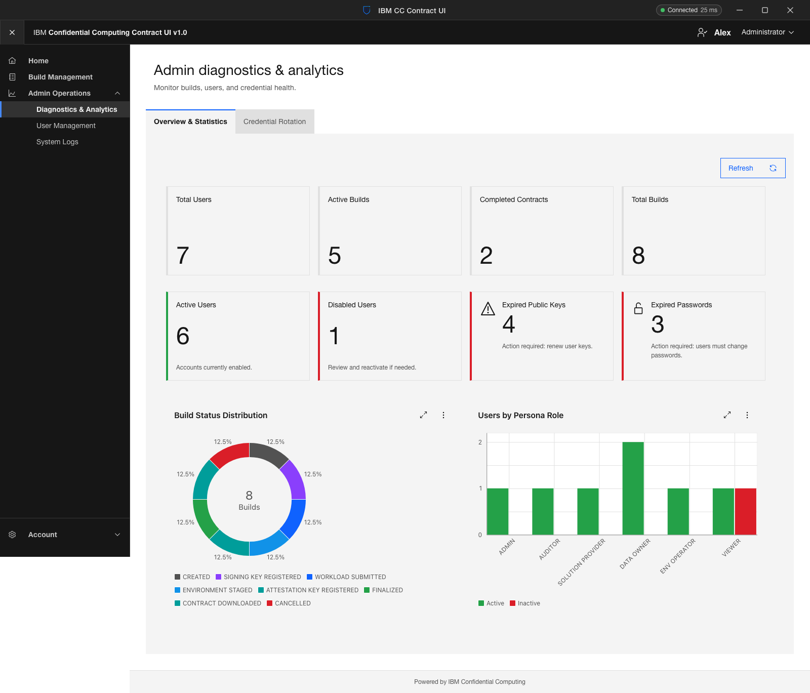</td><td>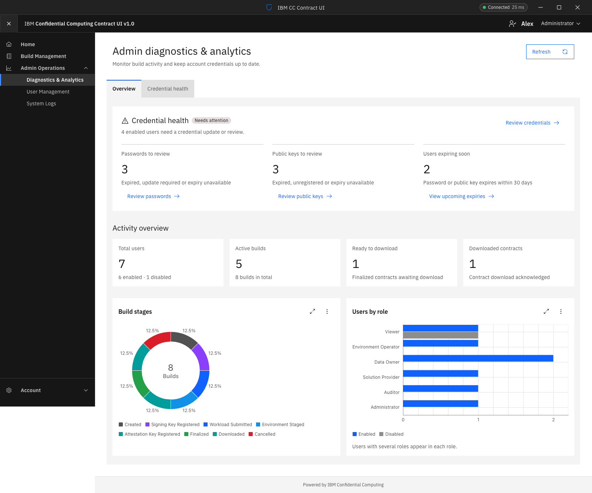</td></tr>
</table>

[Open full-size comparison](comparisons/01-overview.png)

## 28px

<table>
<tr><th>Before — 28px</th><th>After — 28px</th></tr>
<tr><td>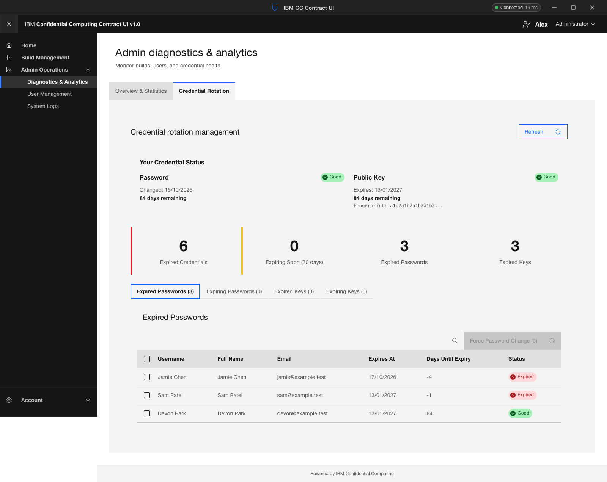</td><td>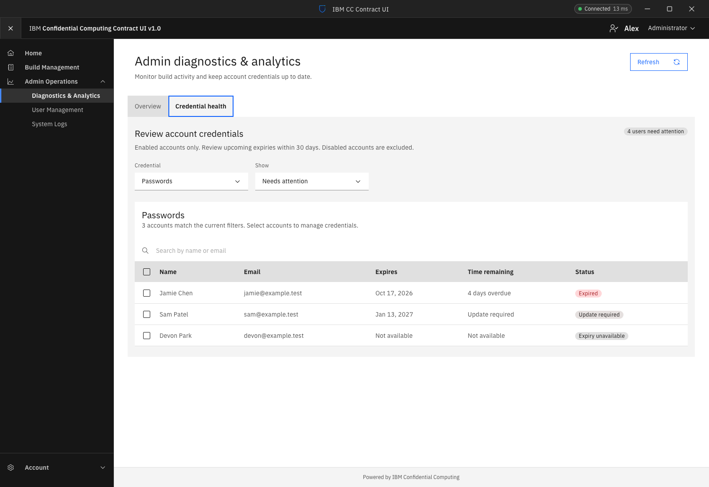</td></tr>
</table>

[Open full-size comparison](comparisons/02-password-review.png)

28px

<table>
<tr><th>Before — 28px</th><th>After — 28px</th></tr>
<tr><td>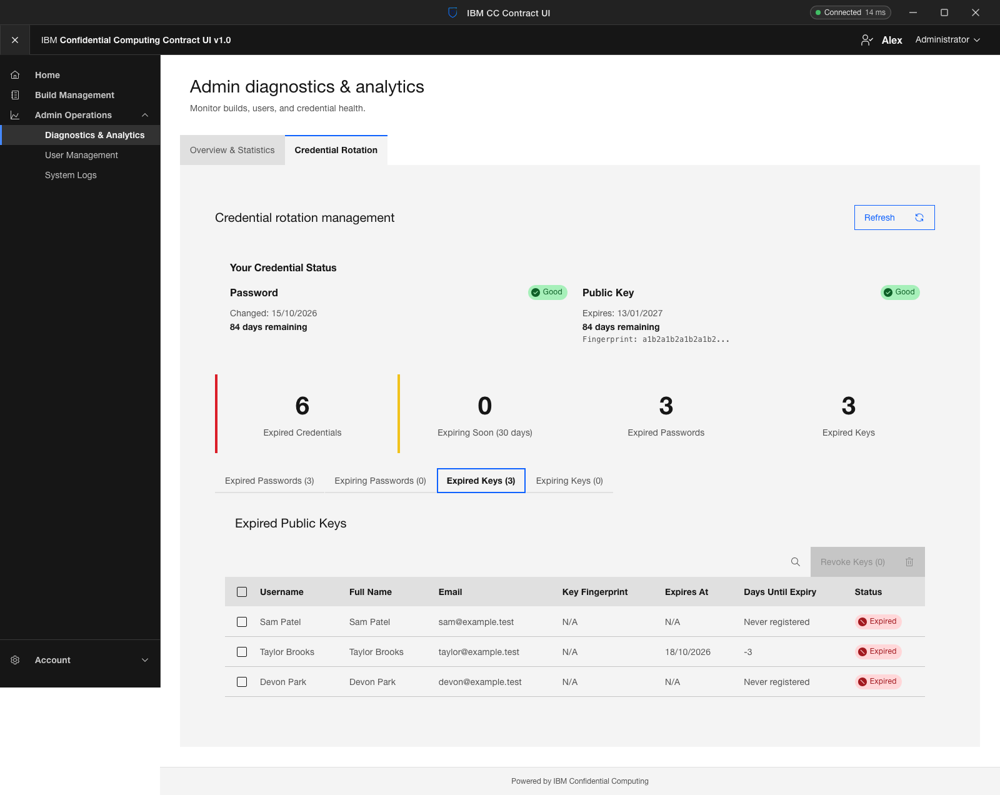</td><td>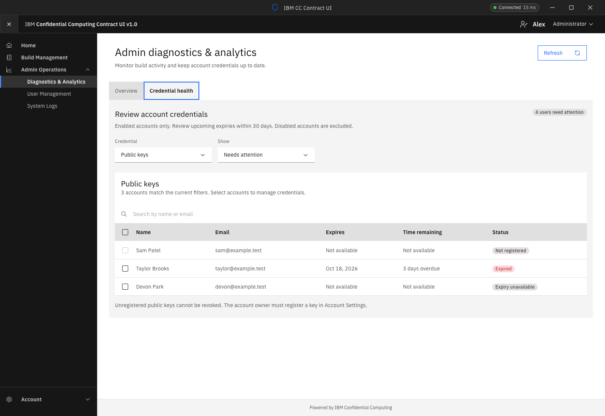</td></tr>
</table>

[Open full-size comparison](comparisons/03-public-key-review.png)

28px

<table>
<tr><th>Before — 28px</th><th>After — 28px</th></tr>
<tr><td>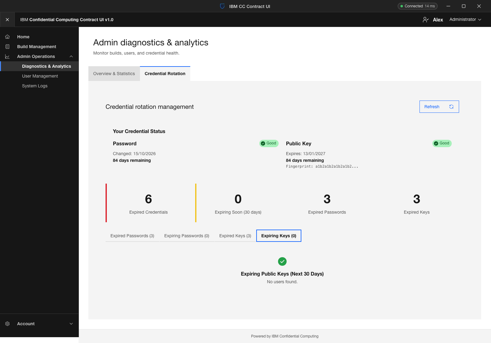</td><td></td></tr>
</table>

[Open full-size comparison](comparisons/04-upcoming-expiries.png)

28px

<table>
<tr><th>Before — 28px</th><th>After — 28px</th></tr>
<tr><td>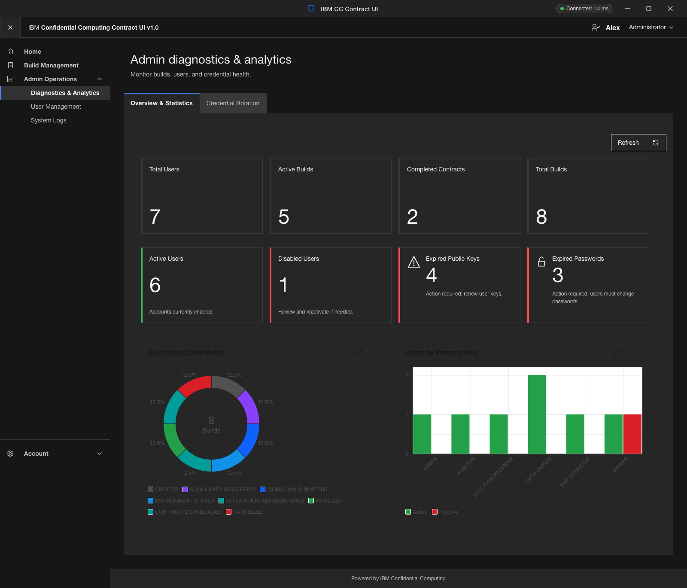</td><td>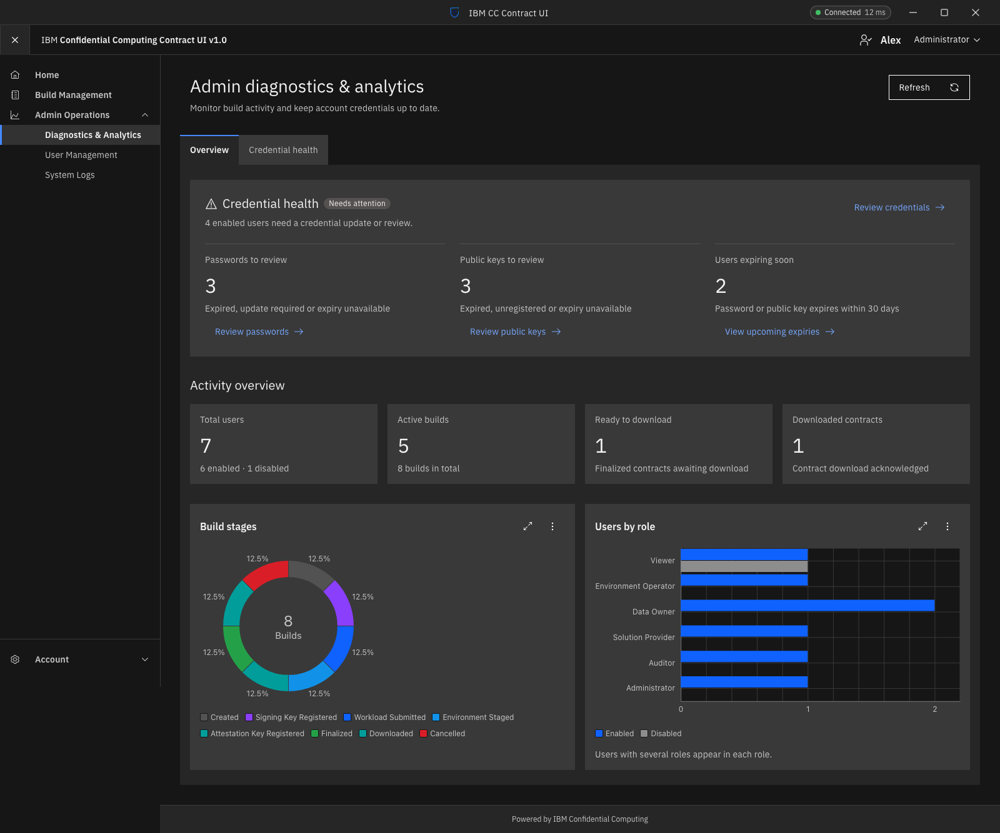</td></tr>
</table>

[Open full-size comparison](comparisons/05-dark-overview.png)

28px

<table>
<tr><th>Before — 28px</th><th>After — 28px</th></tr>
<tr><td>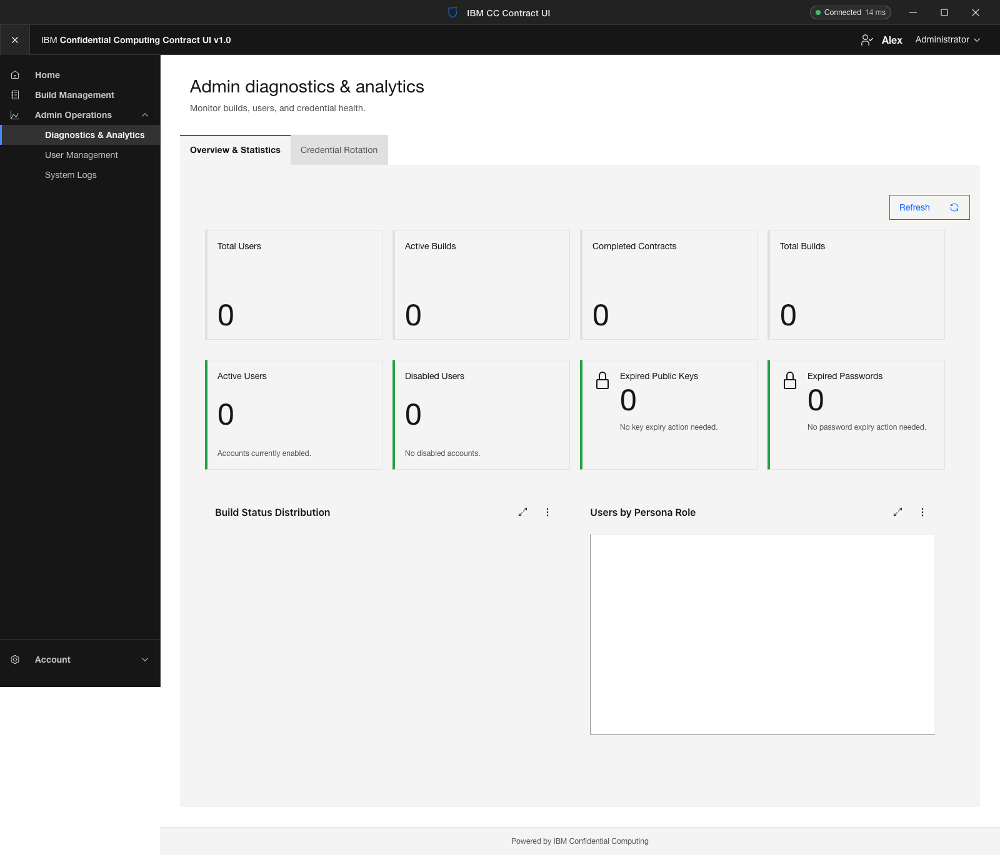</td><td>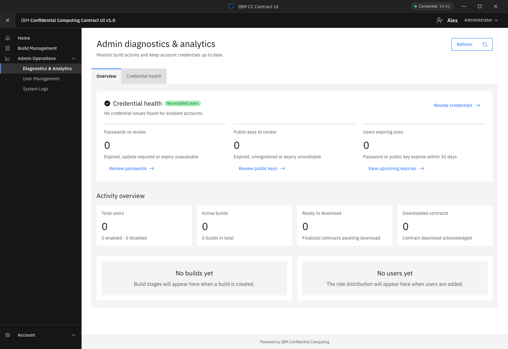</td></tr>
</table>

[Open full-size comparison](comparisons/06-no-data.png)

28px

<table>
<tr><th>Before — 28px</th><th>After — 28px</th></tr>
<tr><td>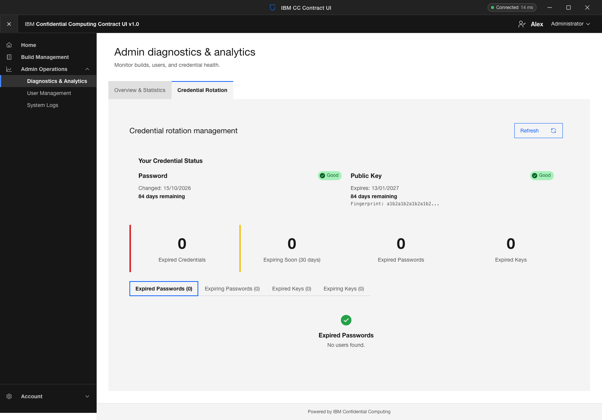</td><td>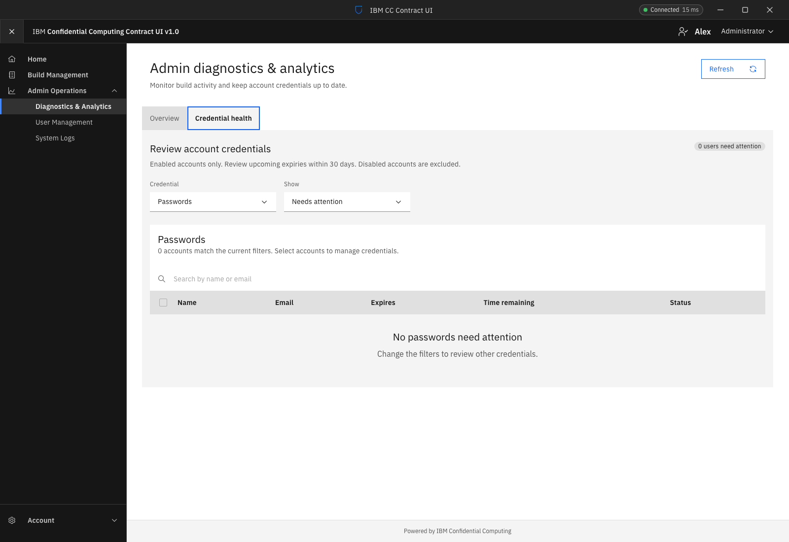</td></tr>
</table>

[Open full-size comparison](comparisons/07-healthy-credentials.png)

