# Build details — before and after

Before: public `ibm-hyper-protect/contract-ui` main at `3b68396284e7f65ab51f405a3838639d91b97b26` (version 1.3.10). After: the approved Build Details rework, including the larger workflow icons and highlighted next stage, without secondary text beneath the stages.

Each pair uses matching sample builds, users, roles, statuses and viewport sizes in the actual React/Carbon application with mocked API responses. The data is synthetic. Dark captures use Carbon's `g100` theme. The 390px view is a narrow-layout stress test.

This branch hosts review images only. It is separate from the implementation branch and does not need to be merged.

## Auditor — next attestation step

Role: `AUDITOR` · Status: `ENVIRONMENT_STAGED` · Theme: `white` · Viewport: 1600 × 1150

<table>
<tr><th>Before</th><th>After</th></tr>
<tr><td><a href="before/auditor-next-step.png">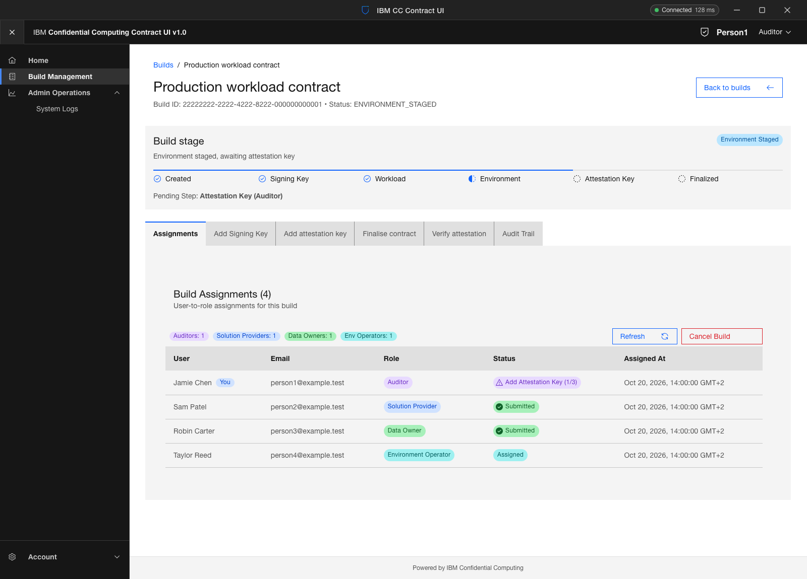</a></td><td><a href="after/auditor-next-step.png">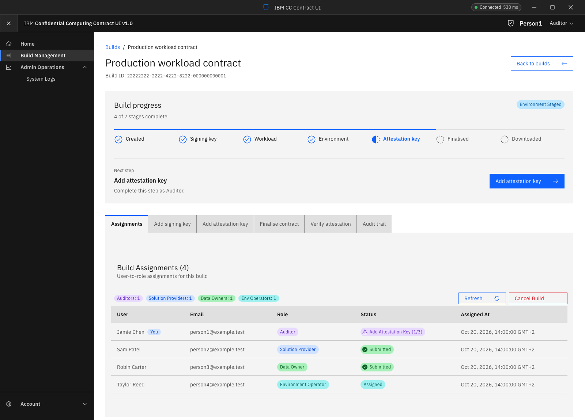</a></td></tr>
</table>

[Full-size side-by-side comparison](comparisons/auditor-next-step.png) · [Before](before/auditor-next-step.png) · [After](after/auditor-next-step.png)

## Administrator — waiting for the Data Owner

Role: `ADMIN` · Status: `WORKLOAD_SUBMITTED` · Theme: `white` · Viewport: 1600 × 1150

<table>
<tr><th>Before</th><th>After</th></tr>
<tr><td><a href="before/waiting-for-role.png">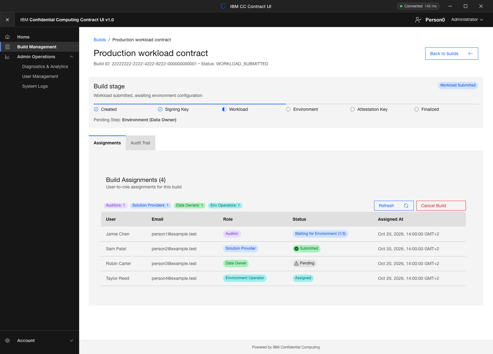</a></td><td><a href="after/waiting-for-role.png">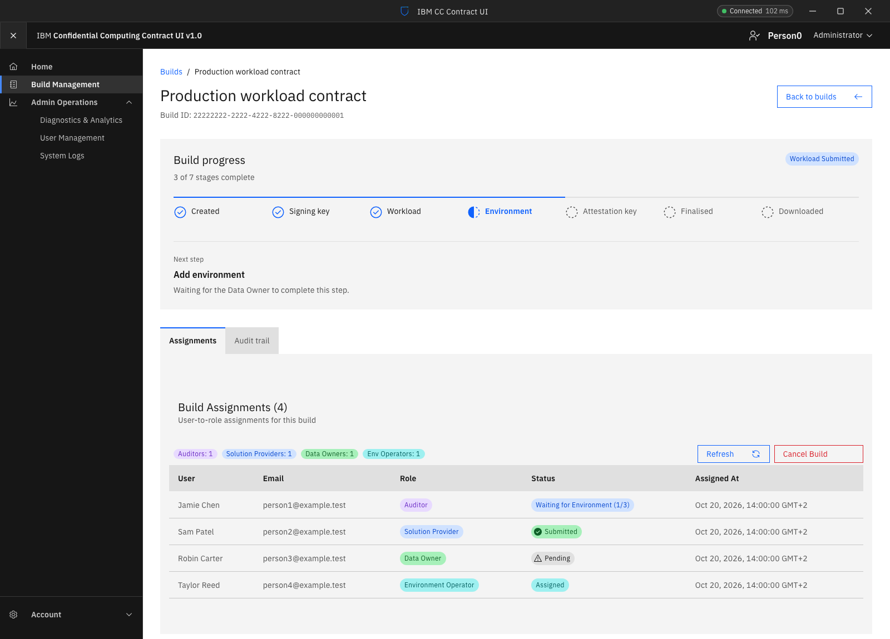</a></td></tr>
</table>

[Full-size side-by-side comparison](comparisons/waiting-for-role.png) · [Before](before/waiting-for-role.png) · [After](after/waiting-for-role.png)

## Environment Operator — ready to export

Role: `ENV_OPERATOR` · Status: `FINALIZED` · Theme: `white` · Viewport: 1600 × 1150

<table>
<tr><th>Before</th><th>After</th></tr>
<tr><td><a href="before/ready-to-export.png">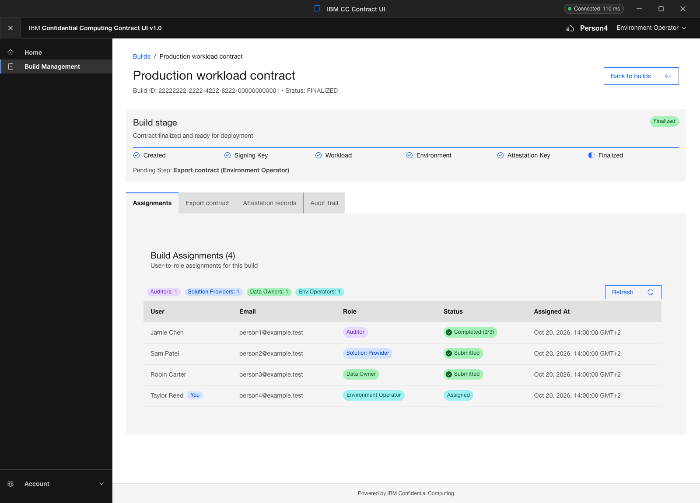</a></td><td><a href="after/ready-to-export.png">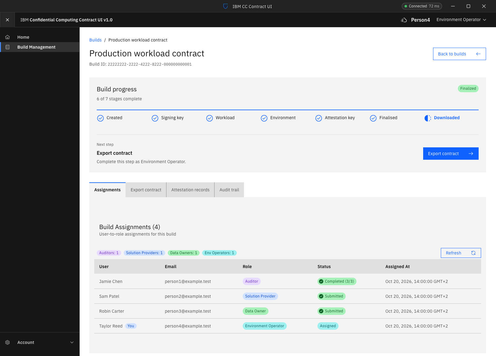</a></td></tr>
</table>

[Full-size side-by-side comparison](comparisons/ready-to-export.png) · [Before](before/ready-to-export.png) · [After](after/ready-to-export.png)

## Cancelled build

Role: `ADMIN` · Status: `CANCELLED` · Theme: `white` · Viewport: 1600 × 1150

<table>
<tr><th>Before</th><th>After</th></tr>
<tr><td><a href="before/cancelled.png">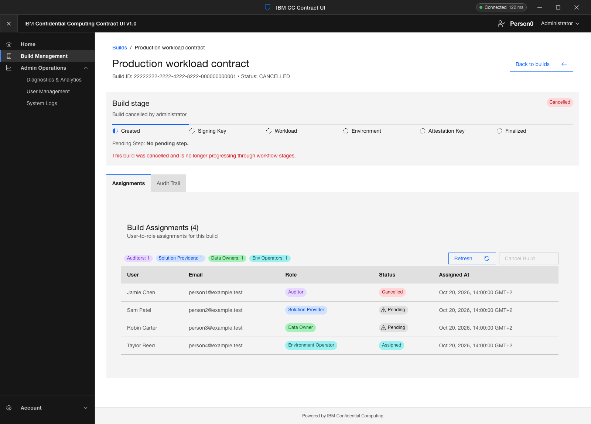</a></td><td><a href="after/cancelled.png">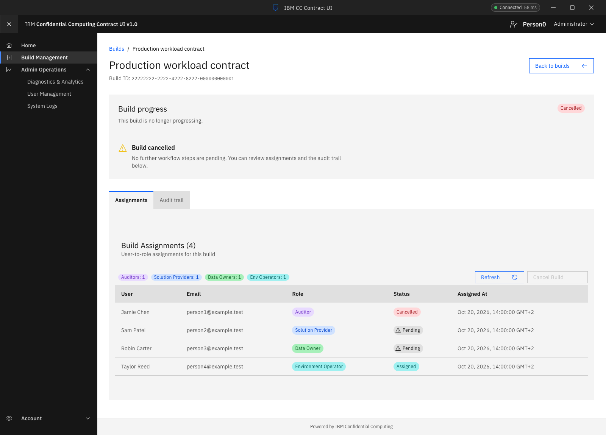</a></td></tr>
</table>

[Full-size side-by-side comparison](comparisons/cancelled.png) · [Before](before/cancelled.png) · [After](after/cancelled.png)

## Downloaded and acknowledged

Role: `ENV_OPERATOR` · Status: `CONTRACT_DOWNLOADED` · Theme: `white` · Viewport: 1600 × 1150

<table>
<tr><th>Before</th><th>After</th></tr>
<tr><td></td><td><a href="after/downloaded.png">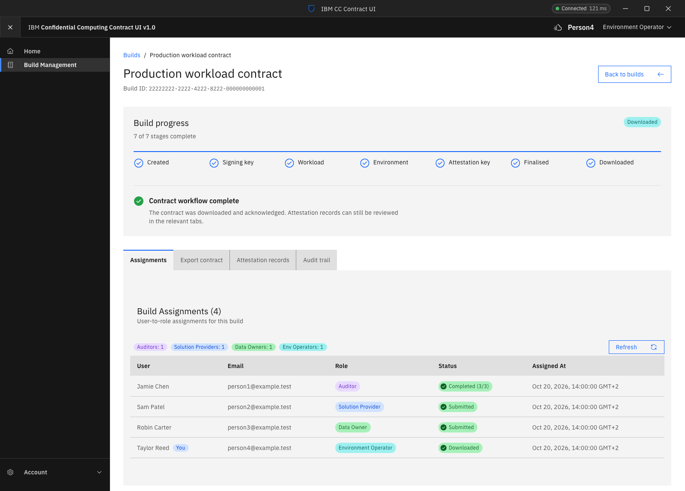</a></td></tr>
</table>

[Full-size side-by-side comparison](comparisons/downloaded.png) · [Before](before/downloaded.png) · [After](after/downloaded.png)

## Data Owner — dark theme

Role: `DATA_OWNER` · Status: `WORKLOAD_SUBMITTED` · Theme: `g100` · Viewport: 1600 × 1150

<table>
<tr><th>Before</th><th>After</th></tr>
<tr><td><a href="before/dark-environment.png">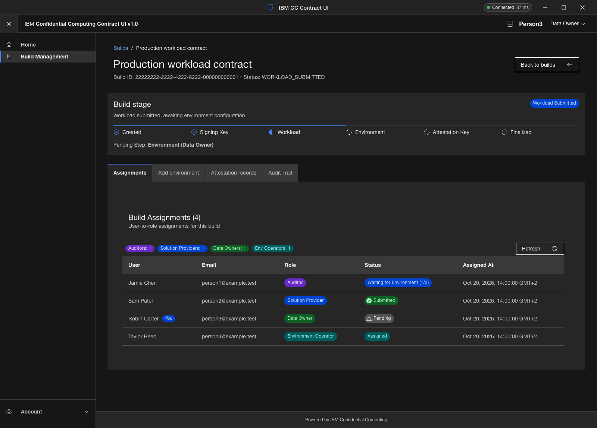</a></td><td><a href="after/dark-environment.png">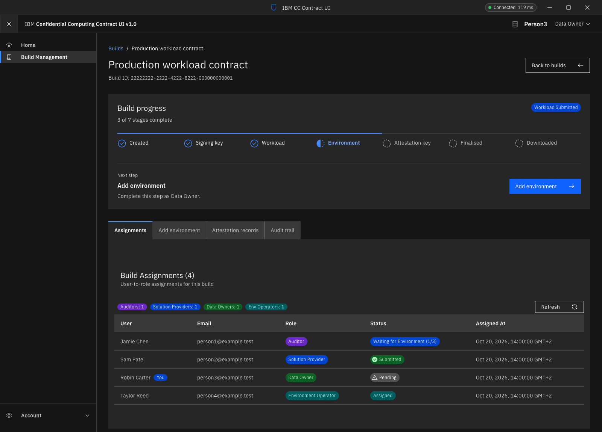</a></td></tr>
</table>

[Full-size side-by-side comparison](comparisons/dark-environment.png) · [Before](before/dark-environment.png) · [After](after/dark-environment.png)

## Auditor — compact layout

Role: `AUDITOR` · Status: `ENVIRONMENT_STAGED` · Theme: `white` · Viewport: 390 × 1400

<table>
<tr><th>Before</th><th>After</th></tr>
<tr><td><a href="before/mobile.png">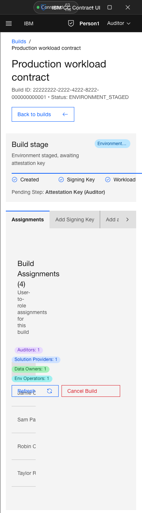</a></td><td><a href="after/mobile.png">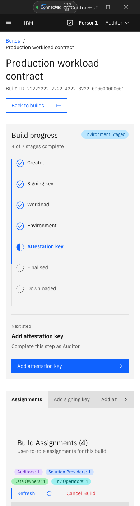</a></td></tr>
</table>

[Full-size side-by-side comparison](comparisons/mobile.png) · [Before](before/mobile.png) · [After](after/mobile.png)

## Legacy build

Role: `AUDITOR` · Status: `AUDITOR_KEYS_REGISTERED` · Theme: `white` · Viewport: 1600 × 1150

<table>
<tr><th>Before</th><th>After</th></tr>
<tr><td><a href="before/legacy.png">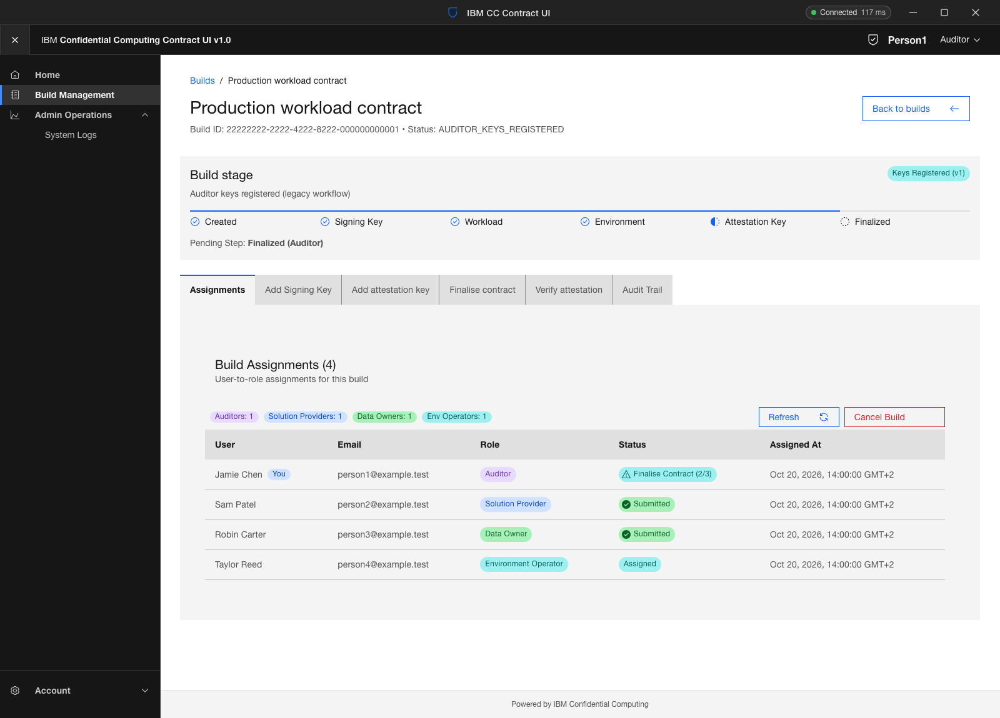</a></td><td><a href="after/legacy.png">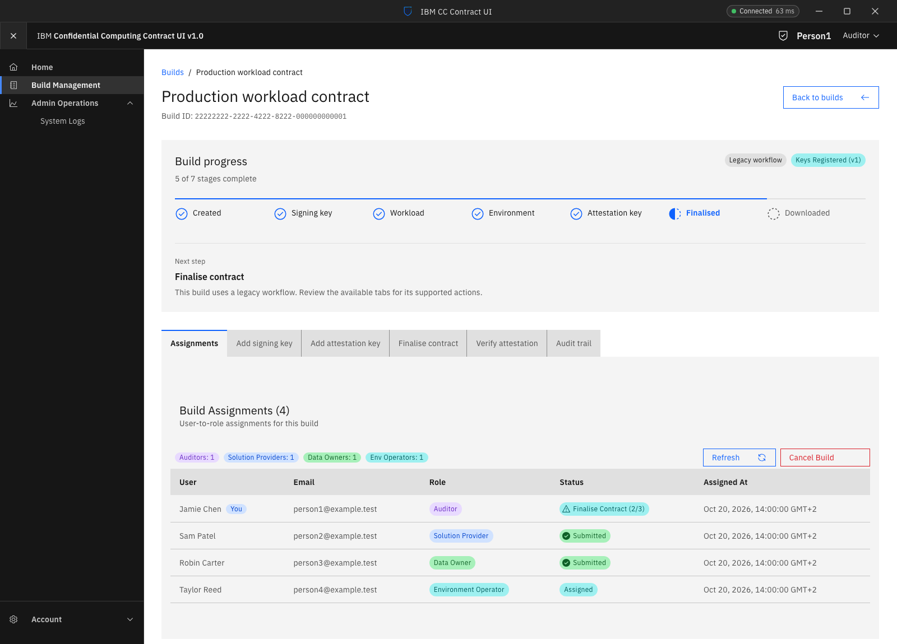</a></td></tr>
</table>

[Full-size side-by-side comparison](comparisons/legacy.png) · [Before](before/legacy.png) · [After](after/legacy.png)

## Unrecognised status

Role: `VIEWER` · Status: `FUTURE_STATUS` · Theme: `white` · Viewport: 1600 × 1150

<table>
<tr><th>Before</th><th>After</th></tr>
<tr><td><a href="before/unknown.png">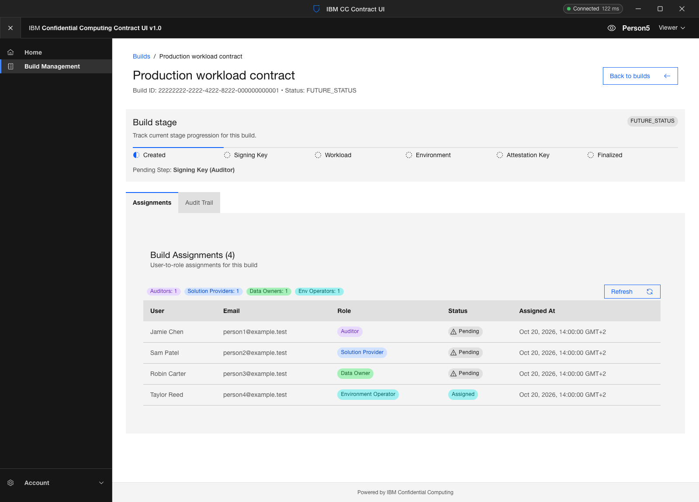</a></td><td><a href="after/unknown.png">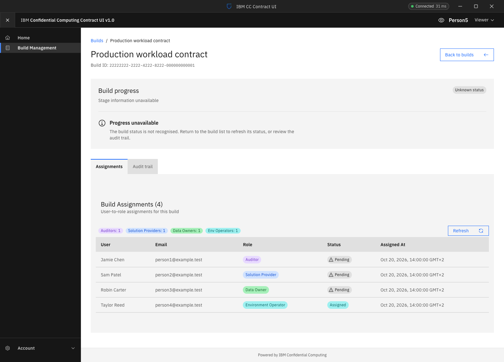</a></td></tr>
</table>

[Full-size side-by-side comparison](comparisons/unknown.png) · [Before](before/unknown.png) · [After](after/unknown.png)
