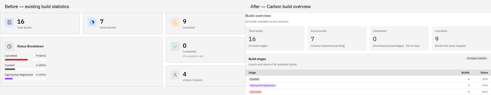
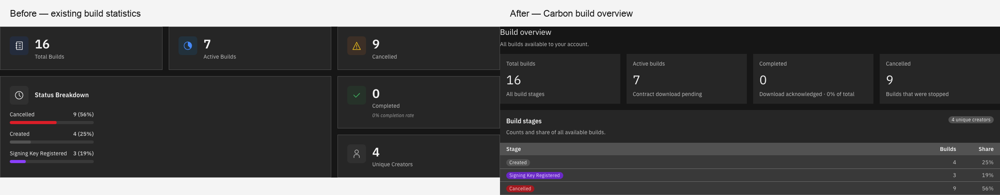
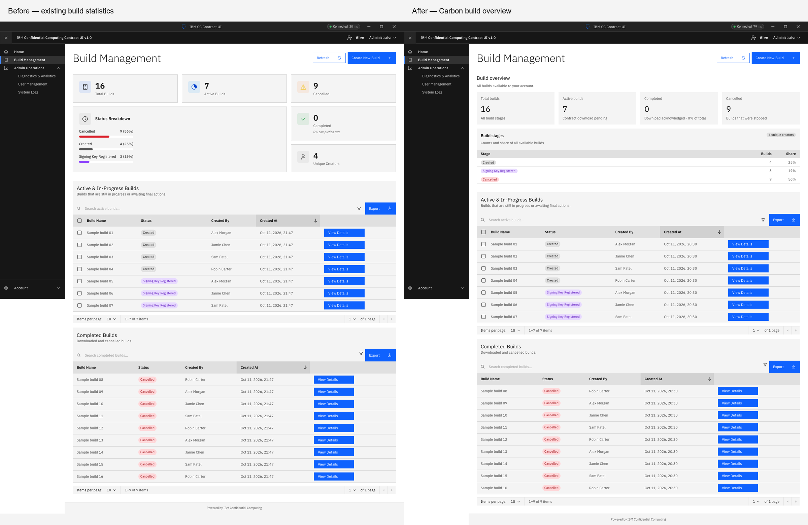
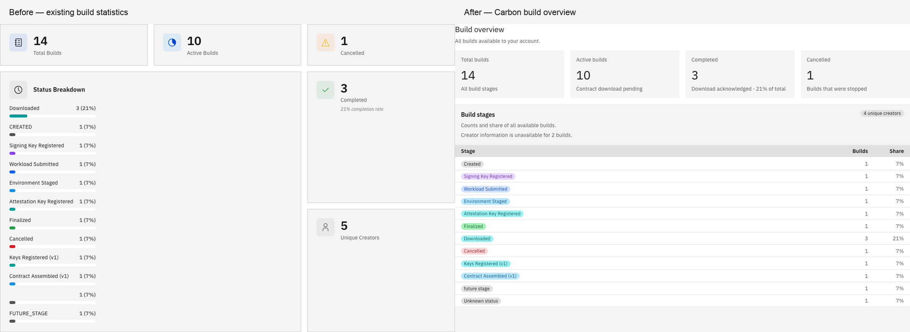
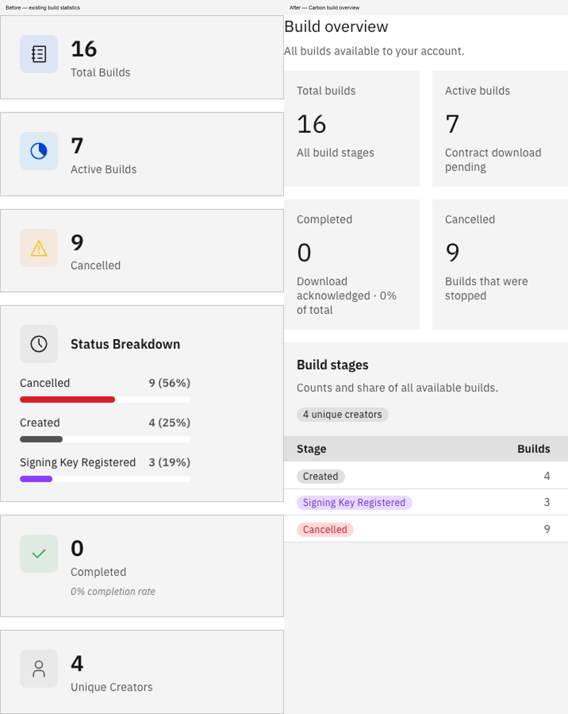
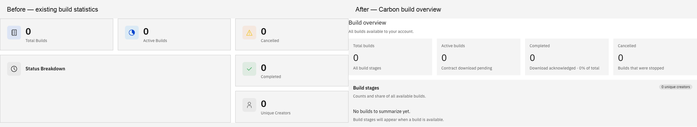
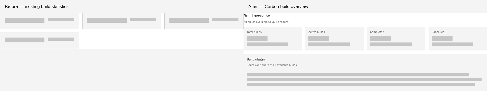

# Build statistics — Carbon rework

Before/after review for the Build Management statistics component. These are rendered React/Carbon captures with identical example builds.

## Scope

- Baseline: public `main` at `d85c00b82962a897a3b4981b430befe608254cd4`.
- Implementation: local branch `fix/build-statistics-carbon`, commit `17471496e54f241e0632775b4d01a0e97cdaa2c8`.
- One independent commit changes only `src/components/BuildStatistics.jsx`, `src/styles/build-statistics.scss` and the statistics styles/import in `src/index.scss`.
- Four aligned Carbon tiles, a compact stage table with standard tags, responsive layout and Carbon typography.
- Missing creator IDs no longer invent an additional creator; unavailable data is disclosed. Completion still means acknowledged contract download.
- No issue or pull request opened for this change yet; awaiting design review.

## Validation

`npm ci`, `npm run build` and `git diff --check` passed. Browser checks covered counts, percentages, creator deduplication, legacy/unknown stages, empty/loading states, refresh, table search, build detail selection, create-dialog cancellation and viewer permissions. Layout checks passed at 390, 768, 900 and 1600 px in white and g100 themes with no document overflow or browser exceptions. [Functional checks](browser-results.json) · [Layout checks](layout-results.json).

The repository has no configured test runner. Browser verification used an external review harness with mocked read-only API responses. No central backend data, accounts, credentials or key registrations were changed. This is UI validation, not a new end-to-end backend test.

## Capture notes

IBM Plex Sans regular and semibold loaded successfully for the baseline capture. Desktop captures use a 1600 × 1100 viewport; the narrow-window example uses 390 × 1100. Only the full-page capture expands the app content scroll area to include the complete build lists. Mixed-stage, empty and loading examples render the actual component directly: Build Management currently shows statistics only after loading and when builds exist. Percentages are rounded independently.

## Comparisons

### Build overview — desktop

[Before](before/01-overview.png) · [After](after/01-overview.png) · [Full comparison](comparisons/01-overview.png)

### Build overview — dark theme

[Before](before/02-dark-overview.png) · [After](after/02-dark-overview.png) · [Full comparison](comparisons/02-dark-overview.png)

### Build Management — full page

[Before](before/03-page-context.png) · [After](after/03-page-context.png) · [Full comparison](comparisons/03-page-context.png)

### Workflow, legacy and unknown stages

[Before](before/04-all-stages.png) · [After](after/04-all-stages.png) · [Full comparison](comparisons/04-all-stages.png)

### Build overview — narrow window

[Before](before/05-mobile.png) · [After](after/05-mobile.png) · [Full comparison](comparisons/05-mobile.png)

### Build overview — empty state

[Before](before/06-empty.png) · [After](after/06-empty.png) · [Full comparison](comparisons/06-empty.png)

### Build overview — loading state

[Before](before/07-loading.png) · [After](after/07-loading.png) · [Full comparison](comparisons/07-loading.png)

