# System Logs — before and after

Review images for the isolated System Logs rework. Before is public `main` at `3b68396284e7f65ab51f405a3838639d91b97b26`; after is `b7a5e6b42d601185b45460d4640aceca932e56bd`, directly on that base. The code change is independent of the analytics, build-statistics and multiple-device-key work.

Actual React/Carbon views use identical deterministic sample accounts and events with mocked read-only API responses. No real central audit data is included. Desktop captures are 1600 × 1100, except the 390 px narrow-window case. Full-page captures expand the content scroll area equally in both versions. The baseline shows details inline; the updated view expands each record. A failed refresh replaces the baseline table and retains it in the updated view.

The interface still loads up to 200 recent events; filtering and export apply to that snapshot. The existing narrow-window desktop titlebar overlap is visible in both versions and remains outside this page change.

Build and 10 native Node helper tests pass. Browser verification covers 20 functional/layout checks, eight light/dark layouts, complete CSV downloads, accessible expansion controls, and loading/error/retry behavior. A final loading/refresh/reload check confirms no renderer warnings after using the current Carbon skeleton API. Result files and PNG SHA-256 values are included alongside the images.

## System logs — desktop

| Before | After |
| --- | --- |
|  |  |

[Full-size comparison](comparisons/01-overview.png)

## System logs — dark theme

| Before | After |
| --- | --- |
| 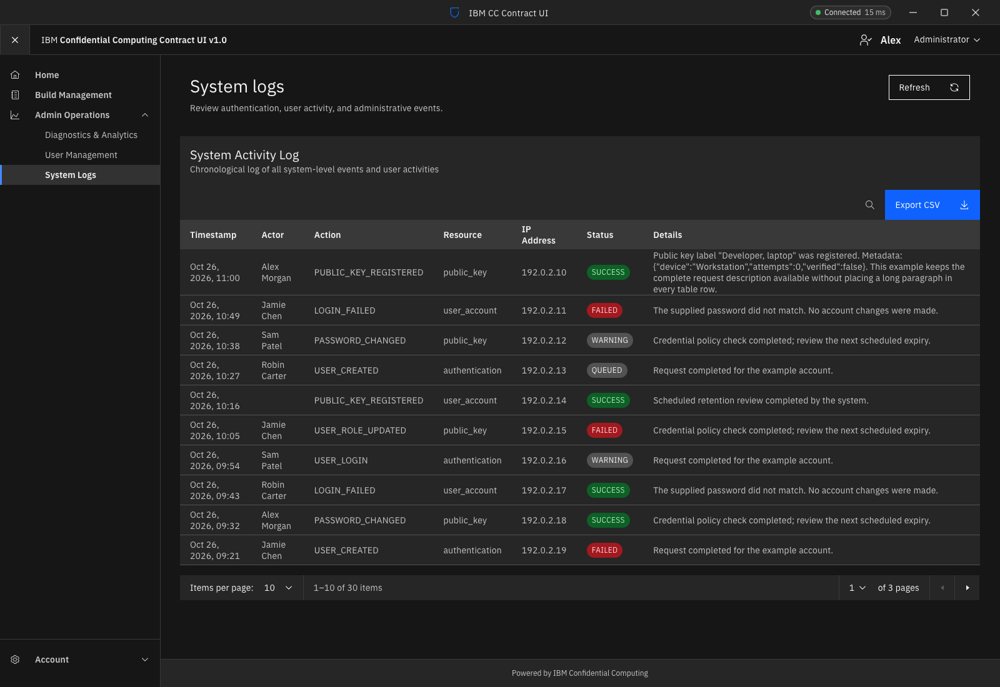 | 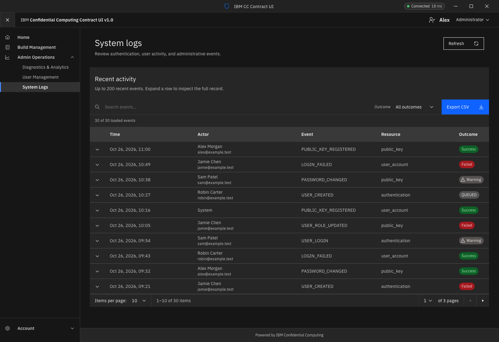 |

[Full-size comparison](comparisons/02-dark-overview.png)

## Event details — inline before, expanded after

| Before | After |
| --- | --- |
| 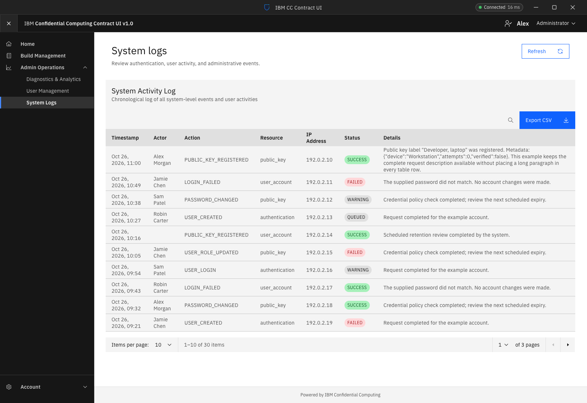 | 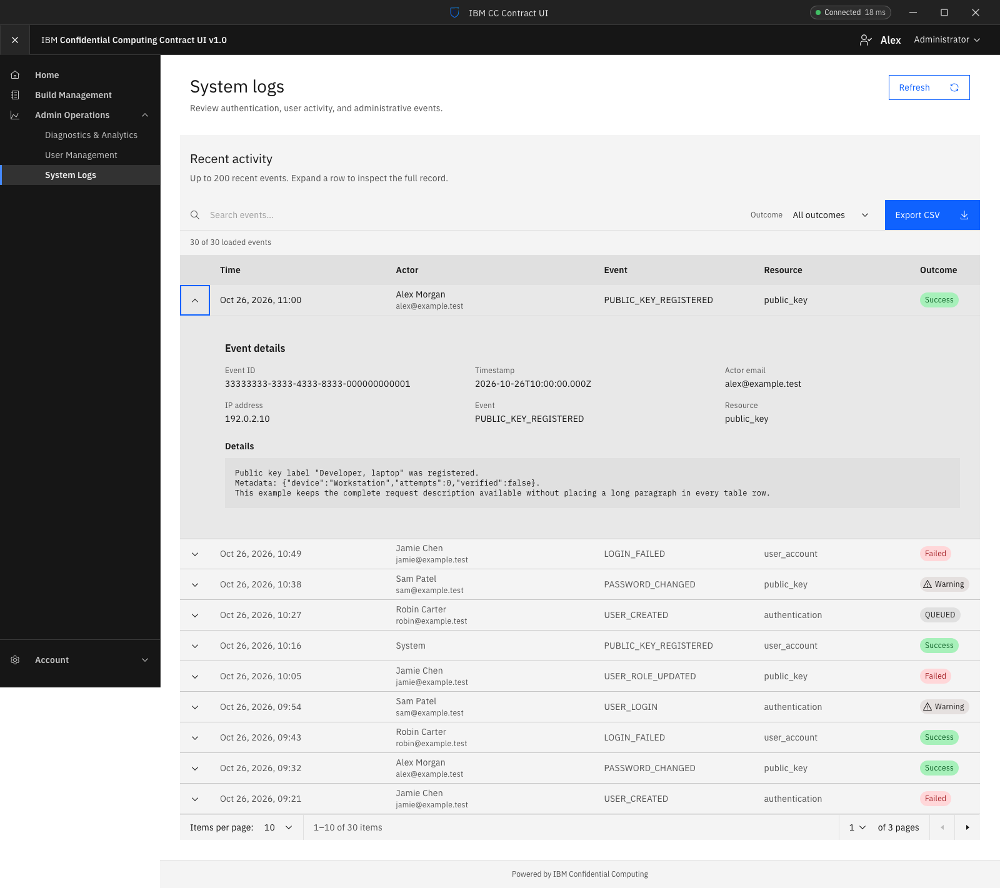 |

[Full-size comparison](comparisons/03-event-details.png)

## System logs — narrow window

| Before | After |
| --- | --- |
| 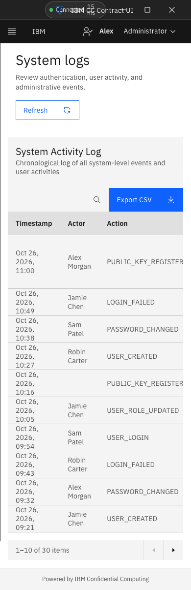 | 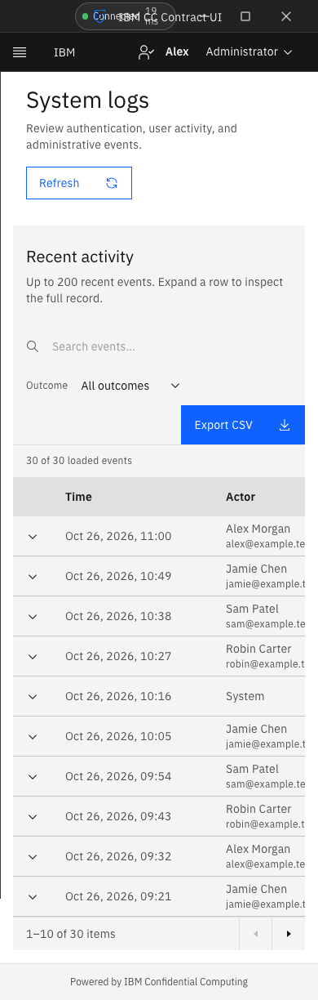 |

[Full-size comparison](comparisons/04-mobile.png)

## System logs — no matching events

| Before | After |
| --- | --- |
| 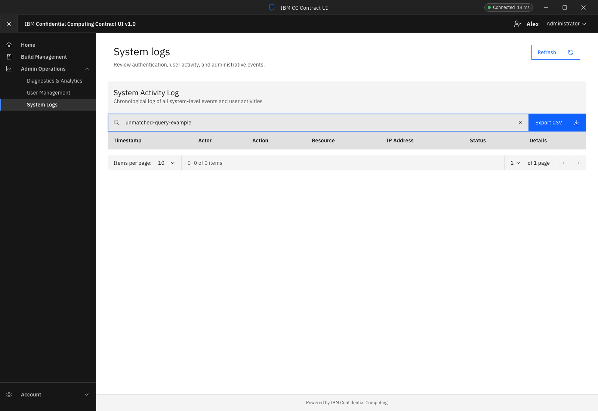 | 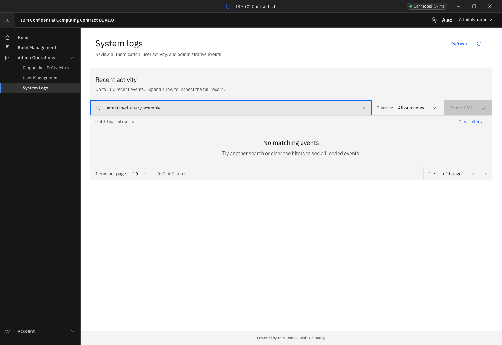 |

[Full-size comparison](comparisons/05-no-matches.png)

## System logs — empty state

| Before | After |
| --- | --- |
|  | 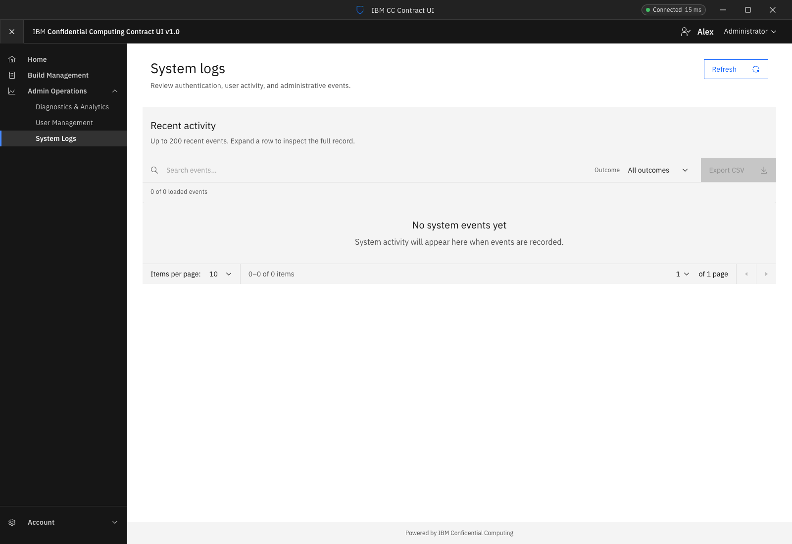 |

[Full-size comparison](comparisons/06-empty.png)

## System logs — failed refresh

| Before | After |
| --- | --- |
| 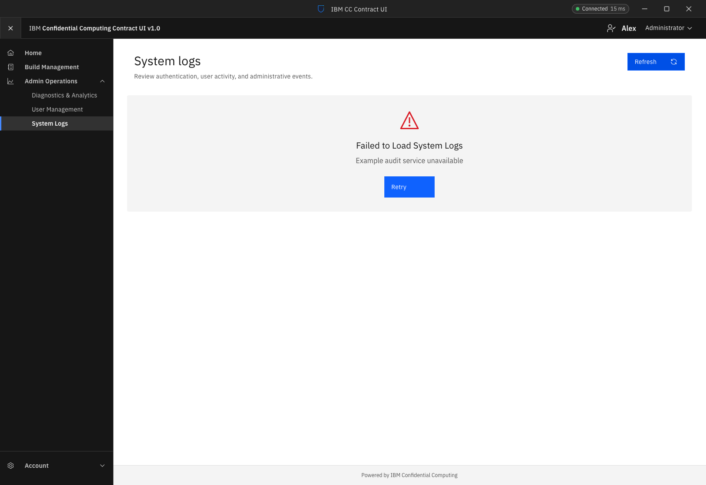 | 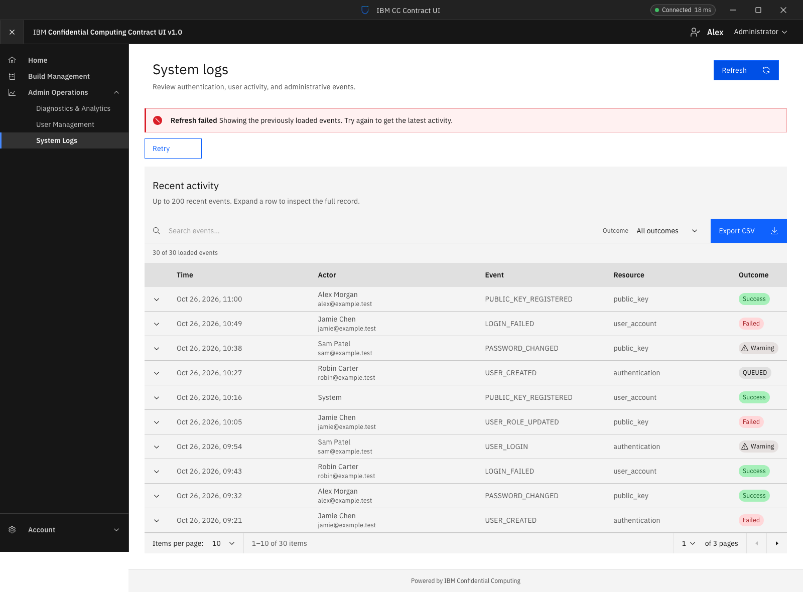 |

[Full-size comparison](comparisons/07-refresh-failure.png)

## System logs — loading state

| Before | After |
| --- | --- |
| 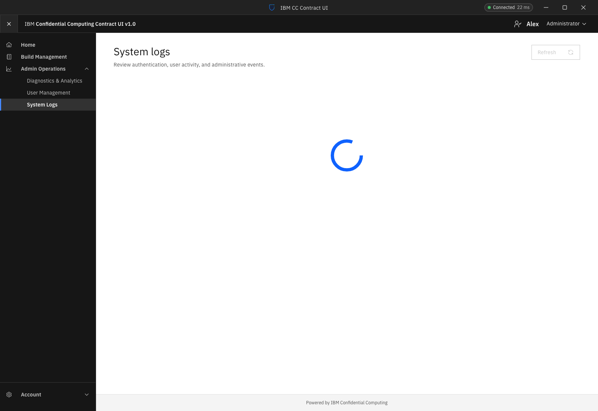 | 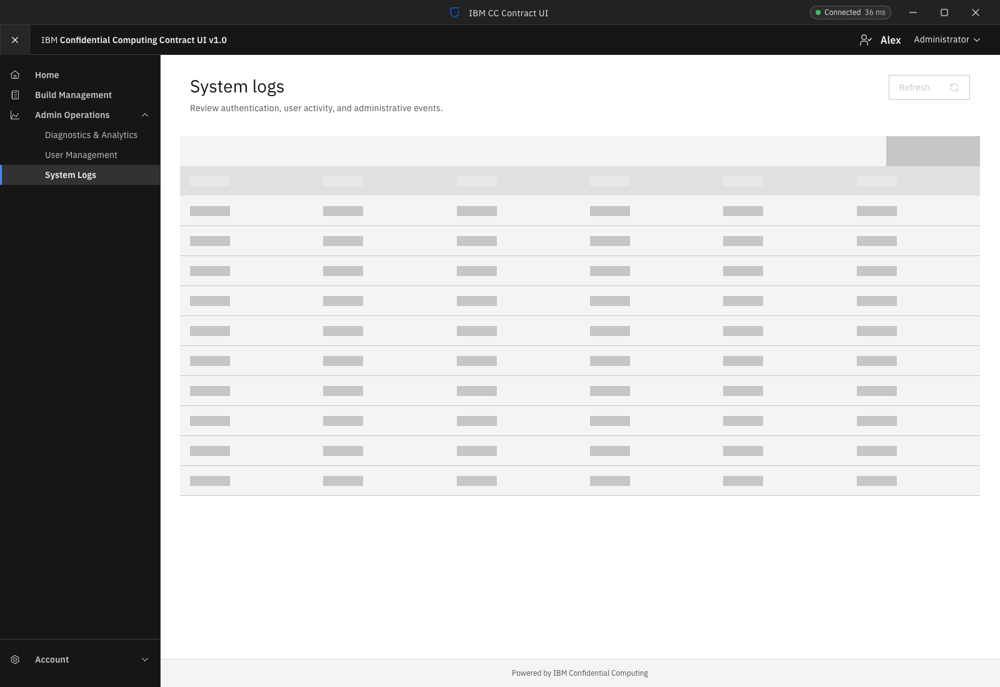 |

[Full-size comparison](comparisons/08-loading.png)

